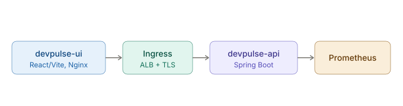

# DevPulse

An internal developer metrics dashboard running on AWS EKS. Surfaces deployment activity and alert history from the platform's observability stack.

## Architecture



Two services deployed into separate Kubernetes namespaces:

| Service | Stack | Namespace |
|---|---|---|
| `devpulse-api` | Spring Boot (Java) | `devpulse-api` |
| `devpulse-ui` | React + Vite, served by Nginx | `devpulse-ui` |

## Platform Stack

| Component | Purpose |
|---|---|
| EKS (Terraform) | Cluster provisioning — VPC, IAM, managed node group (Spot) |
| AWS Load Balancer Controller | ALB Ingress with IRSA |
| cert-manager + Route53 | Automatic TLS via Let's Encrypt DNS-01 |
| external-dns | Route53 record management from Ingress annotations |
| Fluent Bit → CloudWatch | Log shipping |
| kube-prometheus-stack | Metrics and Grafana dashboards |

## Repo Structure

```
/terraform      EKS cluster, VPC, IAM
/helm           Shared chart template + per-service values
/apps
  /devpulse-api Spring Boot application
  /devpulse-ui  React/Vite application
/docs           Architecture decisions, runbooks, operational guides
```

## Running Locally

See individual service READMEs in `/apps/devpulse-api` and `/apps/devpulse-ui`.
